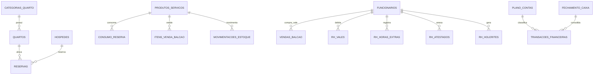

# 🏨 Especificação Arquitetural e Funcional do Novo PMS & ERP Hoteleiro
**Projeto:** Novo Sistema de Gestão Hoteleira, Comercial, RH e Financeira (Substituição e Evolução do Hospedin)  
**Ambiente Piloto:** Hotel Tio Luiz (32 UHs)  
**Arquitetura:** Web App (SPA) + Supabase (PostgreSQL, Auth, Realtime, Storage)  
**Data:** 26 de Outubro de 2026 (Atualizado com PDV Balcão, Vales e Módulo de RH)  

---

## 📌 1. Visão Geral e Objetivos do Projeto

O objetivo deste projeto é desenvolver uma plataforma web hoteleira de alta performance e usabilidade superior, eliminando os gargalos do sistema atual (Hospedin) e incorporando um **módulo financeiro profissional (ERP)**, um **PDV de Balcão com baixa em estoque e gestão de vales**, e um **módulo confidencial de RH/Departamento Pessoal**.

### Principais Pilares:
1. **Operação Ágil na Recepção:** Mapa de reservas interativo com *Drag-and-Drop*, check-in/check-out em menos de 10 segundos, busca instantânea por hóspede/placa de carro/quarto.
2. **PDV de Balcão & Estoque Integrado:** Venda direta para clientes avulsos ou lançamento de consumo como **Vale Funcionário** com baixa automática e rastreabilidade no estoque.
3. **Módulo Exclusivo de RH / DP (Acesso Restrito):** Gestão segura de funcionários, vales consumidos/adiantamentos, horas extras, atestados médicos digitalizados e holerites mensais em PDF.
4. **Governança em Tempo Real (Mobile):** Camareiras e manutenção atualizam status dos quartos pelo próprio celular sem rádio ou papel.
5. **Financeiro Completo e Confiável:** Plano de contas gerencial, controle rigoroso de contas a pagar/receber, fechamento de caixa por turno e conciliação de taxas de cartão.
6. **Inteligência de Negócio (BI & DRE):** Relatórios de lucratividade real (DRE), custos operacionais por quarto ocupado e projeção financeira futura.
7. **Realtime Nativo (Supabase):** Qualquer alteração feita na recepção ou camareira reflete instantaneamente em todas as telas abertas sem recarregar a página (`F5`).

---

## 🗄️ 2. Arquitetura de Dados no Supabase (PostgreSQL)

O Supabase fornecerá o banco relacional, autenticação segura (RBAC), segurança por linha de dados (RLS), eventos em tempo real (*Realtime WebSocket*) e bucket de arquivos (*Storage*).



---

### 2.1. Tabelas Operacionais Hoteleiras

* **`categorias_quarto`**:
  * `id` (UUID, PK)
  * `nome` (ex: "Apto Ar Condicionado", "Apto Ventilador", "Apto Vent Solteiro")
  * `capacidade_adultos`, `capacidade_criancas`
  * `tarifa_padrao` (NUMERIC)
  * `cor_identificacao` (VARCHAR para o calendário)
  * `descricao`, `fotos` (array de URLs do Storage)

* **`quartos` (Unidades Habitacionais - UHs)**:
  * `id` (UUID, PK)
  * `numero` (ex: "101", "102" ... "132")
  * `categoria_id` (FK -> `categorias_quarto`)
  * `andar` (INT)
  * `status_operacional` (ENUM: `livre`, `ocupado`, `bloqueado_manutencao`, `fora_de_servico`)
  * `status_limpeza` (ENUM: `limpo`, `sujo_checkin_pendente`, `em_limpeza`, `inspecionado`)
  * `observacoes_manutencao` (TEXT)

* **`hospedes`**:
  * `id` (UUID, PK)
  * `nome_completo` (VARCHAR)
  * `cpf_cnpj` (VARCHAR, com validação)
  * `documento_tipo`, `documento_numero`, `orgao_emissor`
  * `telefone_whatsapp` (VARCHAR)
  * `email` (VARCHAR)
  * `endereco_completo` (JSONB)
  * `placa_veiculo`, `modelo_veiculo` (VARCHAR)
  * `observacoes_preferencias` (TEXT)
  * `created_at` (TIMESTAMP)

* **`reservas`**:
  * `id` (UUID, PK)
  * `codigo_reserva` (VARCHAR, ex: "RES-2026-0042")
  * `hospede_principal_id` (FK -> `hospedes`)
  * `quarto_id` (FK -> `quartos`)
  * `categoria_id` (FK -> `categorias_quarto`)
  * `status` (ENUM: `pre_reserva`, `confirmada`, `hospedado_checkin`, `finalizada_checkout`, `no_show`, `cancelada`, `bloqueio`)
  * `data_checkin_previsto`, `data_checkout_previsto` (TIMESTAMP)
  * `data_checkin_real`, `data_checkout_real` (TIMESTAMP)
  * `quantidade_adultos`, `quantidade_criancas`
  * `origem_reserva` (ENUM: `balcao`, `whatsapp`, `telefone`, `booking`, `site_proprio`, `empresa`)
  * `valor_diarias_total`, `valor_consumo_total`, `valor_desconto`, `valor_total_geral` (NUMERIC)
  * `valor_pago_adiantado`, `saldo_devedor` (NUMERIC)
  * `notas_internas` (TEXT)

* **`produtos_servicos` (Catálogo e Estoque)**:
  * `id` (UUID, PK)
  * `codigo_barras_ou_ref` (VARCHAR)
  * `nome` (ex: "Água sem Gás 500ml", "Cerveja Heineken", "Refrigerante Lata")
  * `categoria_produto` (ENUM: `frigobar`, `bar_restaurante`, `lavanderia`, `conveniencia`, `taxas`)
  * `preco_custo` (NUMERIC - fundamental para apuração de CMV no DRE)
  * `preco_venda` (NUMERIC)
  * `preco_funcionario` (NUMERIC - opcional se o hotel vende a preço de custo ou com desconto para equipe)
  * `estoque_atual` (NUMERIC / INT)
  * `estoque_minimo` (NUMERIC / INT)
  * `unidade_medida` (VARCHAR, ex: "UN", "LATA", "KG")
  * `ativo` (BOOLEAN)

* **`movimentacoes_estoque`**:
  * `id` (UUID, PK)
  * `produto_id` (FK -> `produtos_servicos`)
  * `tipo_movimentacao` (ENUM: `entrada_compra`, `saida_consumo_quarto`, `saida_venda_balcao`, `saida_vale_funcionario`, `ajuste_inventario`, `perda_quebra`)
  * `quantidade` (NUMERIC)
  * `estoque_anterior`, `estoque_posterior` (NUMERIC)
  * `custo_unitario` (NUMERIC)
  * `referencia_origem_id` (UUID - ID da reserva, ID da venda de balcão ou ID da compra)
  * `usuario_responsavel_id` (FK -> `usuarios`)
  * `data_movimentacao` (TIMESTAMP)

---

### 2.2. Módulo de Vendas de Balcão e Vales

* **`vendas_balcao`**:
  * `id` (UUID, PK)
  * `codigo_venda` (VARCHAR sequencial, ex: "VB-2026-0158")
  * `tipo_venda` (ENUM: `cliente_avulso`, `vale_funcionario`)
  * `funcionario_id` (FK -> `funcionarios`, obrigatório quando `tipo_venda = vale_funcionario`)
  * `cliente_nome_avulso` (VARCHAR, opcional para clientes de passagem)
  * `valor_total_bruto` (NUMERIC)
  * `valor_desconto` (NUMERIC)
  * `valor_total_liquido` (NUMERIC)
  * `forma_pagamento` (ENUM: `dinheiro`, `pix`, `cartao_debito`, `cartao_credito`, `vale_folha`)
  * `fechamento_caixa_id` (FK -> `fechamento_caixa`, vincula ao turno aberto da recepção)
  * `operador_id` (FK -> `usuarios`)
  * `data_venda` (TIMESTAMP)

* **`itens_venda_balcao`**:
  * `id` (UUID, PK)
  * `venda_balcao_id` (FK -> `vendas_balcao`)
  * `produto_id` (FK -> `produtos_servicos`)
  * `quantidade` (INT)
  * `preco_unitario` (NUMERIC)
  * `preco_custo_unitario` (NUMERIC)
  * `valor_total` (NUMERIC)

---

### 2.3. Módulo de RH & Departamento Pessoal (Acesso Restrito)

* **`funcionarios`**:
  * `id` (UUID, PK)
  * `nome_completo` (VARCHAR)
  * `cpf` (VARCHAR, único)
  * `rg`, `orgao_emissor`, `pis_pasep` (VARCHAR)
  * `cargo` (VARCHAR, ex: "Recepcionista", "Camareira", "Manutencionista")
  * `departamento` (ENUM: `recepcao`, `governanca`, `manutencao`, `financeiro_adm`, `gerencia`)
  * `salario_base` (NUMERIC - campo criptografado/restrito ao RH)
  * `data_admissao` (DATE)
  * `data_demissao` (DATE, opcional)
  * `telefone_whatsapp`, `email` (VARCHAR)
  * `status` (ENUM: `ativo`, `ferias`, `afastado_medico`, `desligado`)
  * `limite_mensal_vales` (NUMERIC - teto permitido para compras em vale no balcão)
  * `dados_bancarios` (JSONB: banco, agencia, conta, chave_pix)

* **`rh_vales_adiantamentos`**:
  * `id` (UUID, PK)
  * `funcionario_id` (FK -> `funcionarios`)
  * `tipo_vale` (ENUM: `vale_produto_balcao`, `adiantamento_salarial_dinheiro`, `adiantamento_pix`)
  * `venda_balcao_id` (FK -> `vendas_balcao`, preenchido quando originado no balcão)
  * `descricao` (VARCHAR, ex: "Consumo 2x Red Bull no balcão" ou "Adiantamento quinzenal")
  * `valor` (NUMERIC)
  * `mes_competencia` (INT, ex: 11)
  * `ano_competencia` (INT, ex: 2026)
  * `status_desconto` (ENUM: `pendente_desconto`, `descontado_em_folha`, `cancelado`)
  * `data_solicitacao` (TIMESTAMP)
  * `autorizado_por` (FK -> `usuarios`)

* **`rh_horas_extras`**:
  * `id` (UUID, PK)
  * `funcionario_id` (FK -> `funcionarios`)
  * `data_trabalho` (DATE)
  * `hora_inicio`, `hora_fim` (TIME)
  * `total_horas` (NUMERIC, ex: 2.50)
  * `percentual` (ENUM: `50%`, `100%_domingo_feriado`, `noturno`)
  * `motivo` (TEXT, ex: "Cobrindo turno noturno por ausência")
  * `status_aprovacao` (ENUM: `pendente`, `aprovado`, `pago_folha`, `rejeitado`)
  * `aprovado_por` (FK -> `usuarios`)

* **`rh_atestados_afastamentos`**:
  * `id` (UUID, PK)
  * `funcionario_id` (FK -> `funcionarios`)
  * `data_emissao` (DATE)
  * `data_inicio_afastamento` (DATE)
  * `data_retorno_prevista` (DATE)
  * `dias_afastamento` (INT)
  * `medico_nome`, `crm_numero` (VARCHAR)
  * `cid_codigo` (VARCHAR, sigiloso)
  * `observacoes` (TEXT)
  * `anexo_atestado_url` (URL no Supabase Storage - foto/PDF do documento)
  * `created_at` (TIMESTAMP)

* **`rh_holerites`**:
  * `id` (UUID, PK)
  * `funcionario_id` (FK -> `funcionarios`)
  * `mes_competencia` (INT)
  * `ano_competencia` (INT)
  * `salario_base` (NUMERIC)
  * `total_proventos` (NUMERIC - salário + horas extras + adicionais)
  * `total_vales_descontados` (NUMERIC - soma automática dos vales do mês)
  * `total_descontos_legais` (NUMERIC - INSS, IRRF, faltas)
  * `salario_liquido_receber` (NUMERIC)
  * `arquivo_holerite_url` (URL no Supabase Storage para download do PDF)
  * `status_pagamento` (ENUM: `gerado`, `enviado_ao_funcionario`, `pago`)
  * `data_pagamento` (DATE)

---

### 2.4. Tabelas do Sistema Financeiro Real (ERP)

* **`plano_contas` (Estrutura Gerencial para DRE e Fluxo de Caixa)**:
  * `id` (UUID, PK)
  * `codigo_estruturado` (VARCHAR, ex: "1.01", "2.01.03", "3.01")
  * `nome` (VARCHAR)
  * `tipo` (ENUM: `receita_operacional`, `deducao_receita`, `custo_operacional`, `despesa_administrativa`, `despesa_pessoal`, `despesa_manutencao`, `despesa_financeira`, `tributos`)
  * `natureza` (ENUM: `credito`, `debito`)
  * `ativo` (BOOLEAN)

* **`contas_pagar_receber`**:
  * `id` (UUID, PK)
  * `tipo` (ENUM: `pagar`, `receber`)
  * `descricao` (VARCHAR)
  * `plano_contas_id` (FK -> `plano_contas`)
  * `fornecedor_cliente` (VARCHAR)
  * `valor_nominal` (NUMERIC)
  * `data_emissao`, `data_vencimento`, `data_liquidacao` (DATE)
  * `valor_liquidado`, `valor_juros_multa`, `valor_desconto` (NUMERIC)
  * `status` (ENUM: `pendente`, `pago_recebido`, `parcial`, `cancelado`)
  * `documento_fiscal_url` (URL no Supabase Storage)

* **`fechamento_caixa` (Controle por Turno/Operador)**:
  * `id` (UUID, PK)
  * `data_abertura`, `data_fechamento` (TIMESTAMP)
  * `usuario_responsavel_id` (FK -> `usuarios`)
  * `saldo_inicial_dinheiro` (NUMERIC)
  * `entradas_dinheiro`, `saidas_dinheiro` (sangrias/suprimentos)
  * `saldo_final_dinheiro_apurado`, `saldo_final_dinheiro_informado`, `diferenca_dinheiro` (NUMERIC)
  * `total_pix`, `total_cartao_debito`, `total_cartao_credito`, `total_vales_emitidos` (NUMERIC)
  * `status` (ENUM: `aberto`, `fechado`, `auditado`)

* **`transacoes_financeiras` (Extrato Unificado)**:
  * `id` (UUID, PK)
  * `fechamento_caixa_id` (FK -> `fechamento_caixa`)
  * `reserva_id` (FK -> `reservas`, opcional)
  * `venda_balcao_id` (FK -> `vendas_balcao`, opcional)
  * `conta_id` (FK -> `contas_pagar_receber`, opcional)
  * `plano_contas_id` (FK -> `plano_contas`)
  * `tipo` (ENUM: `entrada`, `saida`)
  * `valor_bruto`, `taxa_operadora`, `valor_liquido` (NUMERIC)
  * `forma_pagamento` (ENUM: `dinheiro`, `pix`, `cartao_debito`, `cartao_credito_vista`, `cartao_credito_parcelado`, `vale_folha`)
  * `created_at` (TIMESTAMP)

---

## ⚡ 3. Supabase Auth, Segurança e RLS (Isolamento do RH)

### 3.1. Perfis de Usuário (RBAC)
1. **Administrador / Proprietário:** Acesso irrestrito a todos os módulos, DRE, auditoria e RH.
2. **RH / Departamento Pessoal:** Acesso exclusivo ao módulo de colaboradores, salários, horas extras, atestados, holerites e espelho de vales.
3. **Recepção:** Mapa de reservas, check-in, check-out, PDV de Balcão (com emissão de vales para a equipe), recebimentos e fechamento de caixa do turno. **Bloqueada de ver salários, atestados e holerites.**
4. **Financeiro / Contabilidade:** Contas a pagar/receber, conciliação de caixa, DRE gerencial, relatórios de CMV e faturamento.
5. **Governança / Camareira:** Acesso simplificado mobile apenas aos quartos e status de limpeza/manutenção.

### 3.2. Políticas RLS de Alta Segurança
```sql
-- Exemplo de RLS para a tabela de holerites e atestados:
CREATE POLICY "Apenas RH e Admin podem visualizar holerites e atestados"
ON rh_holerites
FOR ALL
USING (
  auth.jwt() ->> 'perfil' IN ('admin', 'rh')
);

-- Recepção pode apenas listar colaboradores ativos no balcão para lançar vales:
CREATE POLICY "Recepcao visualiza apenas id e nome do colaborador para vales"
ON funcionarios
FOR SELECT
USING (status = 'ativo');
```

---

## 🖥️ 4. Especificação dos Módulos Operacionais

### 4.1. Dashboard Principal (Visão Panorâmica)
- Indicadores em tempo real: Quartos Disponíveis / Ocupados / Limpeza / Bloqueio.
- Check-ins e check-outs previstos no dia.
- Vendas de balcão do turno e taxa de ocupação instantânea.

### 4.2. Mapa de Reservas Avançado (Gantt Interativo)
- Visão visual por quarto e por dia.
- **Arrastar e Soltar (Drag & Drop):** Trocar quarto ou esticar/reduzir estadia diretamente na grade.
- Status por cores vivas com tooltips informativos.

### 4.3. Check-in e Check-out Express
- Check-in em menos de 10 segundos buscando por CPF ou Placa do Veículo.
- Check-out com conferência rápida de frigobar e envio de comprovante via WhatsApp.

### 4.4. Módulo de Vendas de Balcão (PDV Direto & Vales de Funcionários)
- **Venda Rápida de Produtos (Água, Refrigerante, Cerveja, Snacks, Gelo):**
  - Leitor de código de barras ou botões rápidos na tela.
  - Seleção de pagamento: Dinheiro, Pix, Cartão ou **Vale Funcionário**.
- **Regras para o Vale Funcionário:**
  1. A recepcionista seleciona o nome do colaborador na lista ativa.
  2. O sistema verifica se o funcionário não excedeu seu limite mensal de vales.
  3. A venda é concluída:
     - **Dá baixa imediata no estoque físico** do produto (`movimentacoes_estoque`).
     - **Gera um registro financeiro no fechamento de caixa** (como saída/vale não monetário).
     - **Cria automaticamente um débito em `rh_vales_adiantamentos`** para ser abatido no holerite do mês.
     - Pode imprimir ou enviar um comprovante assinado no celular do colaborador.

### 4.5. Módulo Exclusivo de RH / Departamento Pessoal
- **Menu visível somente para os perfis `RH` e `Admin`:**
  - **Ficha do Colaborador:** Dados contratuais, data de admissão, cargo, salário base e limite de vales.
  - **Painel de Vales e Adiantamentos:** Visualização de todos os consumos de balcão e adiantamentos em dinheiro do mês com filtro por funcionário. Opção de "Aprovar para Desconto em Folha".
  - **Controle de Horas Extras:** Lançamento de horas adicionais com cálculo automático (50% ou 100%) e controle de banco de horas.
  - **Gestão de Atestados Médicos:** Cadastro com data de afastamento, médico e upload do atestado escaneado ou foto pelo celular. O sistema avisa o dia exato do retorno ao trabalho.
  - **Emissão e Arquivo de Holerites:** Upload e armazenamento seguro dos holerites mensais em PDF com demonstrativo claro dos vales descontados.

### 4.6. Módulo de Governança & Limpeza (Mobile)
- Botões grandes para camareiras: *Sujo* ➔ *Em Limpeza* ➔ *Limpo / Inspecionado*.
- Registro de chamados de manutenção com foto.

---

## 📊 5. Sistema Financeiro e Pacote de Relatórios

### 5.1. DRE Gerencial Completo (Demonstrativo de Resultados do Exercício)
Demonstração contábil mensal e anual detalhada:

```text
(+) RECEITA OPERACIONAL BRUTA
    ├── Receita de Diárias / Hospedagem
    ├── Receita de Vendas de Balcão / Bar / Frigobar
    ├── Receita de Serviços (Lavanderia, Estacionamento, Taxas)
    └── Outras Receitas Operacionais

(-) DEDUÇÕES DA RECEITA BRUTA
    ├── Descontos Concedidos
    ├── Cancelamentos e Estornos
    └── Comissões de Canais / OTAs (Booking, etc.)

(=) RECEITA OPERACIONAL LÍQUIDA

(-) CUSTOS DOS SERVIÇOS PRESTADOS (CSP / Custos Variáveis)
    ├── Insumos do Café da Manhã e Alimentos
    ├── Custo das Mercadorias Vendidas (CMV Balcão e Frigobar - baixados do estoque)
    ├── Amenities e Enxovais
    └── Custos de Lavanderia por Quarto

(=) LUCRO BRUTO (Margem de Contribuição Hoteleira)

(-) DESPESAS OPERACIONAIS FIXAS
    ├── Despesas com Pessoal e Encargos (Folha RH, Horas Extras líquidas de vales)
    ├── Ocupação e Utilidades (Energia Elétrica, Água, Gás, Internet)
    ├── Manutenção Predial e Conservação
    ├── Despesas Administrativas e Sistemas (Softwares, Contabilidade)
    └── Marketing e Vendas

(=) EBITDA / LAJIDA (Lucro antes de Juros, Impostos e Depreciações)

(-) DESPESAS FINANCEIRAS
    ├── Taxas de Intermediação de Cartão de Crédito/Débito
    └── Tarifas Bancárias e Juros

(-) TRIBUTOS E IMPOSTOS (Simples Nacional / ISS / IRPJ)

(=) LUCRO LÍQUIDO DO EXERCÍCIO (% Margem Líquida Real)
```

### 5.2. Outros Relatórios Essenciais Inclusos
1. **RevPAR, Diária Média (ADR) e Taxa de Ocupação.**
2. **Relatório de Curva ABC de Vendas de Balcão e Estoque:** Itens mais vendidos, giro de estoque e alertas de estoque mínimo.
3. **Relatório de Fechamento de Vales por Colaborador:** Extrato detalhado para anexar ao fechamento mensal da folha.
4. **Fluxo de Caixa Operacional vs Projetado (30/60/90 dias).**
5. **Auditoria de Maquininhas de Cartão e Taxas Retidas.**

---

## 🎯 6. Status e Próximos Passos

1. [x] **Mapeamento e Diagnóstico do Hospedin** (Concluído)
2. [x] **Especificação de Arquitetura, Banco Supabase, DRE, PDV Balcão e RH** (Concluído neste documento)
3. [ ] **Aprovação do Planejamento**
4. [ ] **Criação do Schema SQL no Supabase** (Tabelas com RLS, triggers de estoque e 32 quartos já cadastrados)
5. [ ] **Início do Desenvolvimento do Frontend Web**
